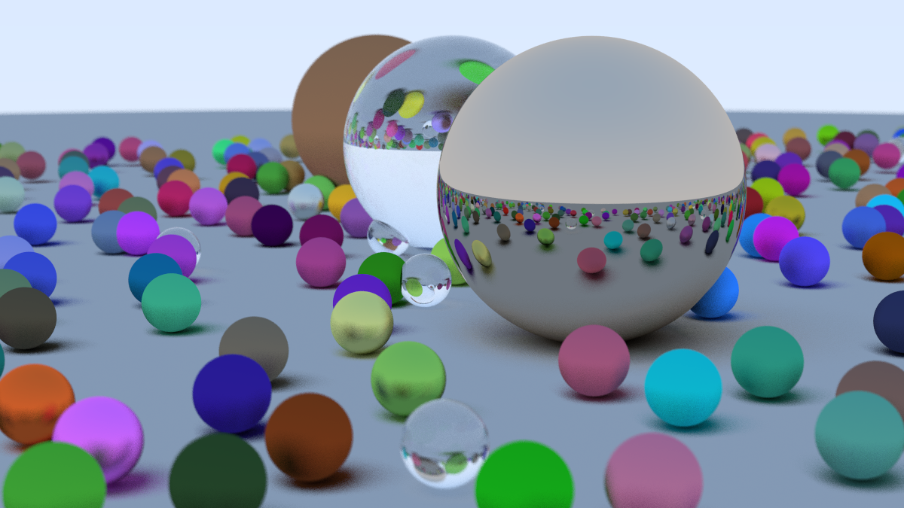

# ray-tracing

A rust implementation of [Ray Tracing In One Weekend](raytracing.github.io/) by Peter Shirley, Trevor David Black, and Steve Hollasch.

Build and run with
```shell
cargo run 
```

## Outputs


